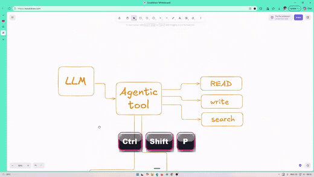
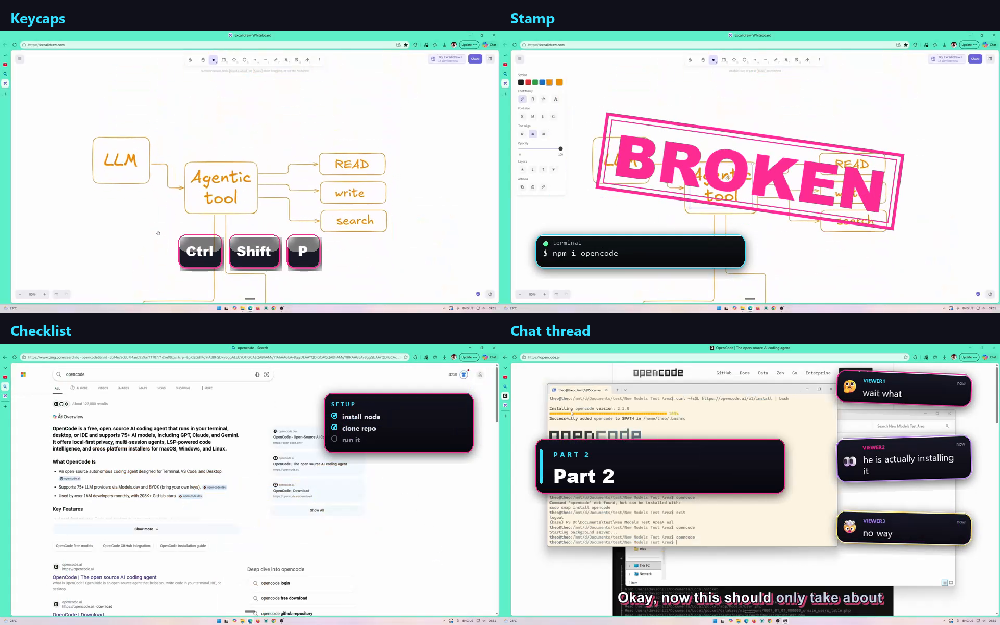
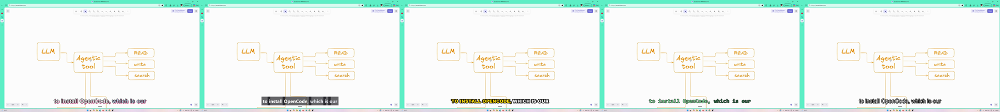

# CwmEditor

A local video editor you drive with an agent. The timeline is JSON, ffmpeg does the rendering, and every change is an undoable operation.

Built for raw recordings: screen captures and talking head footage where the work is cutting filler, tightening dead air, dropping B-roll over the boring parts, and putting memes where the joke lands.





## Requirements

- Node 20 or newer
- ffmpeg and ffprobe with libass. NVENC is used automatically when available.
- Python 3.10+ with Pillow and librosa. `faster-whisper` is optional; without it, transcription falls back to `openai-whisper`.

## Install

```bash
git clone https://github.com/Theolin-Nadasen/cwm-editor.git
cd cwm-editor
python -m pip install pillow librosa faster-whisper
node cwmeditor.mjs doctor
```

There are no npm dependencies. `doctor` reports ffmpeg filters, Python packages, stickers, sounds and beds, so you know what is missing before you start.

## Quick start

```bash
node cwmeditor.mjs init projects/ep01 --source "D:/recordings/ep01.mp4" --name ep01
node cwmeditor.mjs transcribe projects/ep01 --model base
node cwmeditor.mjs theme projects/ep01 --name clean
node cwmeditor.mjs cut-preview projects/ep01 --from 12.3 --to 14.8
node cwmeditor.mjs cut projects/ep01 --from 12.3 --to 14.8 --label "false start"
node cwmeditor.mjs broll projects/ep01 --from 40 --to 52 --src "broll/code.mp4"
node cwmeditor.mjs meme projects/ep01 --at 75.2 --src "memes/shocked.png" --dur 1.2 --scale 0.35
node cwmeditor.mjs text projects/ep01 --at 80 --text "this is the whole trick"
node cwmeditor.mjs music projects/ep01 --src "beds/neon-loop.mp3" --gain -10
node cwmeditor.mjs preview projects/ep01
node cwmeditor.mjs render projects/ep01 --outro
node cwmeditor.mjs qc projects/ep01
node cwmeditor.mjs review projects/ep01
```

For quick tests, cut a short excerpt instead of copying the whole recording:

```bash
node cwmeditor.mjs init projects/ep01-short --source "D:/recordings/ep01.mp4" --excerpt 0:30-2:30
```

Two minutes renders in about 10 seconds as a preview and 19 seconds as a final, which is the right size for iterating.

Open `projects/ep01/out/review.html` to see the contact sheet, transcript, cuts and overlays on one page.

## Project layout

```
project.json  <- the whole edit
media/        <- master recording
work/         <- intermediate renders
out/          <- previews, finals, review.html
```

## Screenshots

Five caption themes, switchable per project:



## The time model (important)

There are two clocks:

- **Master time** is the original recording.
- **Edited time** is what survives the cuts, and it is what you see and what every command takes.

Cuts, B-roll and overlays are stored in master time internally so adding a cut later never shifts an overlay. Transcripts come out of Whisper in master time and are remapped at render.

## Commands

| Command | What it does |
|---|---|
| `init` | Create a project, copy the source into `media/` |
| `transcribe` | Word-level transcript via faster-whisper, falling back to openai-whisper |
| `use-transcript` | Point the project at an existing transcript JSON |
| `cut` | Remove a time range from the master (filler, mistakes, dead air) |
| `cut-preview` | Dry run: how much time and exactly which words disappear |
| `uncut` | Restore a cut by id |
| `broll` | Put a clip or image over the video for a range, voice keeps playing |
| `meme` | Overlay a meme, gif or short clip at a moment |
| `sticker` | Place an emoji sticker (skull, exploding-head, melting, fire, robot) |
| `bubble` | Chat-style popup bubble |
| `chat` | Three-message chat thread, staggered and angled |
| `keycap` | Keycaps for a shortcut |
| `command` | Terminal chip with the command |
| `stamp` | Slammed stamp, BROKEN / SHIPPED |
| `stat` | Big number with a label |
| `chapter` | Part card that slides in |
| `notification` | OS-style notification |
| `checklist` | Progress checklist card |
| `progress` | Animated progress bar |
| `toast` | Achievement toast card |
| `zoom` | Punch-in zoom on a moment |
| `gag-scan` | Find gag moments in the transcript and apply them |
| `stickers` | List the sticker library |
| `text` | Text overlay at a moment |
| `music` | Set the bed, gain, ducking, fit and fade |
| `voice` | Voice cleanup chain on or off |
| `loudness` | Platform loudness preset |
| `beats` | Detect BPM and snap overlays to the beat |
| `sfx` | Place a background sound |
| `sounds` | List sound effects |
| `plan-suggest` | Draft a plan from the transcript |
| `plan-validate` | Check a plan |
| `plan-diff` | Show what applying would change |
| `plan-apply` | Apply the plan |
| `doctor` | Check ffmpeg, Python libs, stickers and sounds |
| `captions` | Karaoke captions on/off, size |
| `themes` | List caption themes |
| `theme` | Switch caption theme |
| `theme-strip` | One frame per theme, tiled, so you can pick |
| `preview` | Half-resolution fast render |
| `render` | Final render, optional brand outro |
| `qc` | Black frames, long silences, loudness, duration drift |
| `review` | Build the HTML review sheet |
| `undo` | Roll back the last timeline change |
| `ops` | Dump cuts, B-roll and overlays as JSON |

All times accept `12.5`, `1:02.5` or `0:01:02.50`.

## Agent surface (MCP)

`mcp/server.mjs` exposes the same operations as MCP tools: `cwmeditor_status`, `cwmeditor_cut`, `cwmeditor_cut_preview`, `cwmeditor_broll`, `cwmeditor_meme`, `cwmeditor_text`, `cwmeditor_music`, `cwmeditor_captions`, `cwmeditor_preview`, `cwmeditor_render`, `cwmeditor_qc`, `cwmeditor_review`, `cwmeditor_undo`.

Add to `opencode.json`:

```json
{
  "mcp": {
    "cwmeditor": {
      "type": "local",
      "command": ["node", "D:/Documents/cwm-editor/mcp/server.mjs"],
      "enabled": true
    }
  }
}
```

The loop that matters: agent proposes a cut with `cwmeditor_cut_preview`, you read the removed words, it applies, renders a preview, checks it, then renders final.

## Audio

Audio is built separately from video, then muxed, so the same chain applies to every render.

**Voice cleanup** runs a high-pass, FFT denoise, de-esser, gentle compression, presence EQ and limiter. Strengths: `light`, `normal`, `strong`. New projects default to `light`.

```bash
node cwmeditor.mjs voice projects/ep01 --on --strength normal
```

**Music beds** auto-loop or trim to the video length, fade in and out, and duck under the voice. Duck profiles: `soft`, `hard`, `off`.

```bash
node cwmeditor.mjs music projects/ep01 --src beds/neon-100.wav --gain -10 --duck soft --fit loop --fade 0.6
```

**Beat sync** detects BPM and beat times with librosa, then snaps zooms, stamps and cards to the nearest beat.

```bash
node cwmeditor.mjs beats projects/ep01 --snap --window 0.3
```

**Loudness presets** set the integrated target and true peak.

```bash
node cwmeditor.mjs loudness projects/ep01 --platform youtube
```

Targets: YouTube, TikTok and Instagram `-14 LUFS`, podcast `-16`, cinema `-23`. Previews are normalised too, so what you hear matches the final.

## Planning the edit

The plan is optional. Every tool still works on its own, so an agent can add a single sticker or one sound without touching a plan.

A plan is a JSON file that describes the whole edit in **master time**, split into sections, with a reason on every op. The agent writes it, the validator checks it, the diff shows the impact, then it applies once and tags everything it created.

```bash
node cwmeditor.mjs plan-suggest projects/ep01 --write
node cwmeditor.mjs plan-validate projects/ep01
node cwmeditor.mjs plan-diff projects/ep01
node cwmeditor.mjs plan-apply projects/ep01 --dry-run
node cwmeditor.mjs plan-apply projects/ep01
```

Ops are the same vocabulary as the CLI: `cut`, `broll`, `zoom`, `sticker`, `bubble`, `chat`, `toast`, `text`, `keycap`, `command`, `stamp`, `stat`, `chapter`, `notification`, `checklist`, `progress`.

```json
{
  "version": 1,
  "timebase": "master",
  "profile": "tutorial",
  "intent": "Show the install, then the first agent run",
  "sections": [
    {
      "id": "hook",
      "title": "Hook",
      "start": 0,
      "end": 25,
      "goal": "promise the payoff in the first 15 seconds",
      "ops": [
        { "op": "cut", "from": 12.3, "to": 13.1, "reason": "false start" },
        { "op": "stamp", "at": 24.8, "text": "IT WORKS", "reason": "first success" }
      ]
    }
  ],
  "audio": {
    "voice": { "clean": true, "strength": "light" },
    "music": { "src": "beds/neon-100.wav", "gain": -10, "duck": "soft" },
    "loudness": "youtube",
    "sfx": [{ "at": 12.3, "sound": "whoosh", "gain": -6 }]
  }
}
```

Applying is idempotent: anything the previous plan created is removed first, and manual work is kept. Gag density is a soft signal with generous budgets, and `"density": "off"` disables it entirely.

`plan-suggest` produces a draft: sections at pause boundaries, silence cuts, chapter cards and gag suggestions.

## Background sounds

```bash
node cwmeditor.mjs sounds
node cwmeditor.mjs sfx projects/ep01 --at 12 --sound whoosh --gain -6
node cwmeditor.mjs sfx-remove projects/ep01 --id x1
```

Sounds are mixed under the voice next to the gag sounds, with their own gain.

## Themes

Five caption and title themes, switchable per project:

| Name | Look | Best on |
|---|---|---|
| `neon` | White text, dark outline, magenta shadow | Dark footage |
| `clean` | White text on a dark box | Screen recordings, light backgrounds |
| `punch` | Yellow uppercase, heavy black outline | Any background, loudest |
| `terminal` | Monospace green | Code and dev videos |
| `classic` | White with a black outline | Neutral fallback |

```bash
node cwmeditor.mjs theme projects/ep01 --name clean
node cwmeditor.mjs theme-strip projects/ep01 --at 5   # compare all five
```

The strip writes `out/themes/strip.png` plus one PNG per theme.

Captions are generated at the render resolution, not the project resolution, so a half-size preview gets crisp text instead of downscaled text. Outline and spacing scale with the frame height, so a theme looks the same at preview and final size.

## Speed

- **Single pass.** With no B-roll or memes, cuts, captions and audio are one ffmpeg command. That took an 11 minute video preview from 100 seconds to 54 seconds.
- **NVENC** is used automatically when ffmpeg supports it. Force x264 with `CWMEDITOR_ENCODER=x264`.
- **Excerpts.** `--excerpt` copies a slice of a long recording for quick tests.
- **Two minutes** of 1080p: about 10 seconds preview, about 19 seconds final.

## Gags

Twelve on-screen gags, all driven by the same overlay track:

- **Sticker**: an emoji from the local Fluent Emoji set, MIT licensed, 39 of them in `stickers/`
- **Bubble**: a chat-style popup with an avatar, generated as a PNG card
- **Chat**: a thread of up to 5 angled messages that appear one at a time and vanish together
- **Toast**: an achievement card with an icon, generated as a PNG card, drops in from the top
- **Zoom**: a punch-in on a moment, applied as its own video pass
- **Keycap**: keycaps for a shortcut, bottom centre
- **Command**: terminal chip with the exact command
- **Stamp**: slam-down stamp with an impact sound
- **Stat**: big number and label
- **Chapter**: part card that slides in from the left
- **Notification**: OS-style card that slides in top right
- **Checklist**: setup list with ticked and pending items
- **Progress**: animated progress bar for installs and waits

Motion presets: **pop** (85% to full in 100ms), **slam** (135% down to full), **slide** (from the left or right), **drop** (toast from the top). Sounds: `pop`, `ding`, `click`, `boom`, `whoosh`, `error`, all synthesised locally.

### Persistent HUDs

Add `--until end` to keep a card on screen until the video finishes. That turns checklists, counters and stat cards into HUD elements instead of one-off pops.

```bash
node cwmeditor.mjs stat projects/ep01 --at 5 --until end --value 3 --label retries --pos bottom-left
```

Checklists can tick over time with `--ticks`, which takes `seconds:doneCount` pairs separated by `|`. The card stays put and only the checkmarks change, so it does not re-pop.

```bash
node cwmeditor.mjs checklist projects/ep01 --at 5 --until end \
  --title SETUP --items "install node|clone repo|run it|ship it" \
  --done 1 --ticks "40:2|60:3|80:4"
```

Every gag has a sound: `ding` for toasts, `pop` for bubbles and stickers, `error` for failures. The sounds are synthesised locally by `scripts/make-sfx.mjs`, so there is no licence to track. Silence one with `--sound none`.

```bash
node cwmeditor.mjs sticker projects/ep01 --at 12 --name skull
node cwmeditor.mjs bubble projects/ep01 --at 38 --text "wait what" --icon thinking
node cwmeditor.mjs chat projects/ep01 --at 41 --msgs "wait what|he actually did it|no way"
node cwmeditor.mjs toast projects/ep01 --at 71 --text "It works first try" --icon check
node cwmeditor.mjs zoom projects/ep01 --at 95 --factor 1.3
node cwmeditor.mjs keycap projects/ep01 --at 12 --keys "Ctrl|Shift|P"
node cwmeditor.mjs command projects/ep01 --at 20 --cmd "npm i opencode"
node cwmeditor.mjs stamp projects/ep01 --at 30 --text BROKEN
node cwmeditor.mjs stat projects/ep01 --at 40 --value 42 --label errors
node cwmeditor.mjs chapter projects/ep01 --at 50 --part "PART 2" --title "where it breaks"
node cwmeditor.mjs notification projects/ep01 --at 60 --title "Low disk space" --body "Free up space"
node cwmeditor.mjs checklist projects/ep01 --at 70 --title SETUP --items "install node|clone repo|run it" --done 1,2
node cwmeditor.mjs progress projects/ep01 --at 80 --label installing --dur 3
node cwmeditor.mjs stat projects/ep01 --at 5 --until end --value 3 --label retries --pos bottom-left
node cwmeditor.mjs checklist projects/ep01 --at 5 --until end --title SETUP --items "install node|clone repo|run it|ship it" --done 1 --ticks "40:2|60:3|80:4"
```

`gag-scan` reads the transcript and proposes beats:

```bash
node cwmeditor.mjs gag-scan projects/ep01
node cwmeditor.mjs gag-scan projects/ep01 --apply --ids 1,3
```

It writes `out/gags.md` and `out/gags.json` with a reason per beat. Defaults: error words get a skull sticker, confusion words get a "wait what" bubble, success words get an achievement toast, and pauses over 2 seconds get a zoom.

Density is enforced, 18 seconds minimum between gags and 3 per minute by default. Override with `--min-gap` and `--max-per-min`, or drop a `gags.json` in the project to replace the rules entirely:

```json
{
  "density": { "minGap": 12, "maxPerMinute": 4 },
  "rules": [
    { "match": ["install"], "gag": "sticker:rocket", "dur": 1.4 },
    { "match": ["wait", "what"], "gag": "bubble:wait what", "dur": 2 }
  ]
}
```

## Memes

`meme` takes any image or short clip. `--scale` is a fraction of frame width, `--pos` is `center`, `top`, `bottom`, `top-left`, `top-right`, `bottom-left`, `bottom-right`.

Keep a local library in `memes/`. Tenor's API was shut down in June 2026, and Giphy library content is not licensed for commercial video, so the safe route is your own reaction clips, royalty-free footage, or reactions you generate.

## Notes

- Everything runs locally. No accounts, no per-minute credits.
- Captions are burned with libass from generated ASS, so they survive cuts and match edited time.
- `render` uses loudnorm to hit -14 LUFS for YouTube; previews are normalised too, so they match the final.
- The outro appender is reused from the CWM pipeline (`add-outro.ps1`), override with `ADD_OUTRO_PS1`.
- `node tests/smoke.mjs` builds a synthetic project and checks render, captions, QC and review.

## License

MIT. See [LICENSE](LICENSE).

If CwmEditor saves you time, a star helps other people find it.
